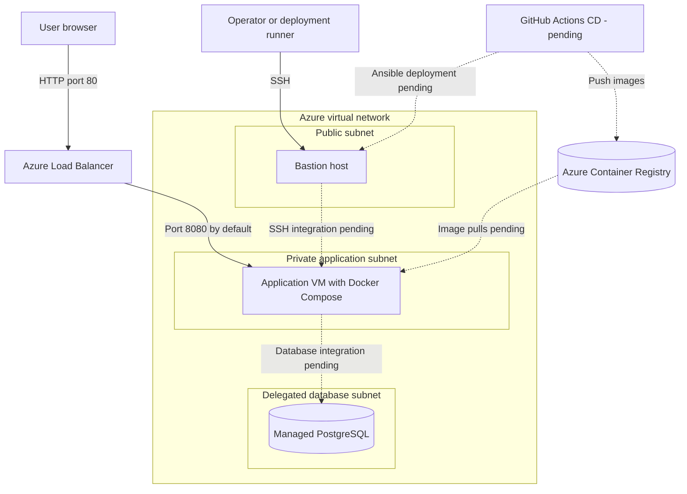

# AgroCompare

**Compare agricultural prices. Make smarter market decisions.**

## African Context

Smallholder farmers across East Africa often lack information about crop prices in nearby markets. AgroCompare brings sample prices from several markets into one place, helping demonstrate how accessible market information can support decisions about where to sell.

**The prices in this application are sample data for demonstration, not real market prices.**

## Team Members

- Jongkuch Isaac Chol Anyar ([@Jongkuch1](https://github.com/Jongkuch1)) — Team Lead / DevOps
- Agertu Diriba Aliko ([@AgertuDA](https://github.com/AgertuDA)) — Backend
- Betelhem Feleke Cheleno ([@Betelhemf567](https://github.com/Betelhemf567)) — Frontend, Tests and CI
- Beni Niyogisubizo ([@be-niy](https://github.com/be-niy)) — Project Board and Documentation

## Project Overview

AgroCompare is a web application for comparing agricultural prices across sample East African markets.

A Flask API reads bundled JSON data and returns it to a React frontend. Users can filter observations and compare the same crop across markets.

The repository includes Docker configuration, continuous integration, security scanning, Terraform infrastructure configuration and Ansible configuration management.

The complete automated cloud deployment remains under integration. Infrastructure configuration in the repository does not, by itself, establish that the application is deployed successfully.

## Target Users

- Smallholder farmers deciding where to sell.
- Small traders comparing market prices.
- Agricultural extension officers advising farmers.

## Core Features

- View sample prices for crops including maize, tomatoes, onions, teff and potatoes.
- Filter observations by product or market.
- Compare a product across two markets.
- View the date associated with each price observation.
- Display bundled fallback data when the frontend cannot reach the API.

The fallback-data notice matters during testing: a populated page alone does not prove that the backend is available.

## Technology Stack

| Area | Technology |
| --- | --- |
| Frontend | React 18, JavaScript, Vite and CSS |
| Backend | Python, Flask and Flask-CORS |
| Application data | Bundled JSON |
| Tests | pytest and Node's built-in test runner |
| Containers | Docker and Docker Compose |
| CI | GitHub Actions |
| Security scans | pip-audit, npm audit, Trivy and Gitleaks |
| Infrastructure | Terraform and Azure |
| Configuration management | Ansible |
| Configured cloud services | Azure VMs, Load Balancer, Container Registry and managed PostgreSQL |

PostgreSQL infrastructure configuration is present, but database integration with the application has not been verified.

## Getting Started

### Prerequisites

For development without containers:

- Git.
- Node.js 18 or newer, subject to the frontend package requirements.
- Python 3.11, matching the backend CI environment.
- npm, included with Node.js.

For the container-based setup, see [Run with Docker Compose](#run-with-docker-compose).

### Clone the repository

```bash
git clone https://github.com/Jongkuch1/sokowatch.git
cd sokowatch
```

The repository and some existing configuration use the AgroCompare name. The clone commands above follow the remote URL used by the team.

### Start the backend

From the repository root:

```bash
cd backend
python3 -m venv venv
source venv/bin/activate
python -m pip install -r requirements.txt
python app.py
```

The backend serves the API at:

```text
http://localhost:5000
```

### Start the frontend

Open another terminal and run from the repository root:

```bash
cd frontend
npm install
npm run dev
```

Open the URL printed by Vite, normally:

```text
http://localhost:5173
```

The development server forwards `/api` requests to the backend.

### Run the tests

Install the dependencies first. For backend tests, activate the backend virtual environment.

Run each command from the repository root:

```bash
(cd backend && python -m pytest)
(cd frontend && npm test)
```

### Usage

Open the frontend and use the search and market filters to narrow the results. Use the comparison section to view a product across two markets.

If the API is unavailable, the frontend can display bundled sample data with a notice. Check that notice when verifying backend connectivity.

While the backend is running, inspect the API directly:

```bash
curl -fsS http://localhost:5000/api/health
curl -fsS http://localhost:5000/api/prices
curl -fsS "http://localhost:5000/api/prices?product=maize"
curl -fsS "http://localhost:5000/api/prices?market=m-a"
```

The health endpoint returns:

```json
{"status":"ok"}
```

`/api/prices` returns three lists:

- `products`
- `markets`
- `observations`

Each observation includes a product, market, price, currency, unit and date. The `product` and `market` query parameters filter observations.

See [frontend/README.md](frontend/README.md) and [backend/README.md](backend/README.md) for additional application details.

## Project Structure

| Path | Purpose |
| --- | --- |
| `backend/` | Flask API, bundled data and backend tests |
| `frontend/` | React application, frontend tests and frontend Dockerfile |
| `Dockerfile` | Backend image definition |
| `docker-compose.yml` | Local frontend and backend services |
| `.github/workflows/ci.yml` | Application checks and Docker builds |
| `.github/workflows/security.yml` | Dependency, image and secret scans |
| `terraform/` | Azure infrastructure configuration |
| `ansible/` | Playbook, inventory and configuration roles |
| `docs/DEMO_CHECKLIST.md` | Individual demo preparation checklist |
| `SECURITY.md` | Security findings, remediation and limitations |
| `CHANGELOG.md` | Evolution across the Formatives and Summative |

## Links

- [GitHub Repository](https://github.com/Jongkuch1/sokowatch)
- [Project Board](https://github.com/users/Jongkuch1/projects/7)
- [Issues](https://github.com/Jongkuch1/sokowatch/issues)
- [Pull Requests](https://github.com/Jongkuch1/sokowatch/pulls)
- [Backend README](backend/README.md)
- [Frontend README](frontend/README.md)
- [Team Participation Sheet](https://docs.google.com/spreadsheets/d/1apJFWX5-BIjBpPVhniaPmolSvizBKX4rTitMLN0pWt4/edit?gid=0#gid=0)

## Collaboration and Branch Protection

Work on a feature branch and open a pull request targeting `main`. Link the relevant issue and request a teammate's review.

The team's intended protection rules include:

- Pull requests and at least one approving review.
- Required CI checks before merging.
- Review of new changes after an earlier approval.
- Resolution of review conversations.
- An up-to-date branch before merging.

GitHub settings determine which rules are enforced. Verify the current rules and required check names in the repository settings before the final demonstration; workflow files alone do not enforce branch protection.

Include `Closes #N` in a pull request description when its merge should close an issue.

## Run with Docker Compose

### Prerequisites

- Git.
- Docker Engine with the Docker Compose plugin, or Docker Desktop.
- Available ports 8080 and 5000.
- On Windows with WSL, Docker Desktop integration enabled for the Ubuntu distribution.

Docker installs application dependencies inside the images. Local Python and Node.js installations are not required for this method.

### Build and start

From the repository root:

```bash
docker compose up --build -d
```

The first build downloads base images and installs dependencies. The frontend starts after the backend health check passes.

Open:

- Frontend: http://localhost:8080
- Backend health: http://localhost:5000/api/health
- Price API: http://localhost:5000/api/prices

Nginx serves the built React application. Requests to `/api/` are forwarded to the backend over the shared Compose network.

### Check service status

```bash
docker compose ps
curl -fsS http://localhost:5000/api/health
curl -fsS http://localhost:8080/api/health
```

Both health requests should return:

```json
{"status":"ok"}
```

The first checks the backend directly. The second checks the frontend proxy path to the backend.

Only the backend service has a Compose health check. A running frontend container does not have a separate `healthy` status configured.

### View logs

```bash
docker compose logs --tail=100 backend frontend
docker compose logs -f backend frontend
```

Press Ctrl+C to stop following logs. The containers continue running.

### Stop and rebuild

Stop and remove the containers and Compose network:

```bash
docker compose down
```

Rebuild after changing application code or dependencies:

```bash
docker compose up --build -d
```

The current Compose application uses sample JSON data packaged in the backend image. It does not configure a database service or persistent data volume. Dataset changes require rebuilding the backend image.

### Troubleshooting

| Problem | Check |
| --- | --- |
| Docker unavailable in WSL | Enable the Ubuntu distribution in Docker Desktop's WSL Integration settings and reopen the terminal |
| Cannot connect to Docker | Start Docker Desktop or Docker Engine and run `docker info` |
| Port already allocated | Identify and stop the process or container using port 5000 or 8080 |
| Backend unhealthy | Inspect `docker compose logs backend` and `docker compose ps` |
| Frontend fails to start | Check backend health because frontend startup depends on it |
| Page loads but API fails | Check both health URLs and inspect frontend and backend logs |
| Sample data appears despite an API failure | Look for the frontend fallback notice and test the API directly |
| Build fails | Inspect the first build error and check dependency downloads and network connectivity |

## Continuous Integration

The application CI workflow is defined in `.github/workflows/ci.yml`.

It runs on:

- Pushes to branches other than `main`.
- Pull requests targeting `main`.

| Job | Checks |
| --- | --- |
| `frontend-tests` | Node.js 18, dependency installation, linting, tests and frontend build |
| `backend-tests` | Python 3.11, dependency installation, Flake8 and pytest |
| `docker-build` | Backend and frontend Docker image builds |

Each job fails when one of its commands fails.

The Docker job validates image builds. The reviewed CI workflow does not publish images or deploy the application.

### Inspect a workflow run

1. Open the repository's **Actions** tab.
2. Select **CI**.
3. Open the run for the relevant branch or pull request.
4. Open a job and expand its steps.
5. For a failure, inspect the first relevant error, correct its cause and push the fix.

A passing CI run confirms only the checks that actually ran. It does not prove that the cloud application is deployed or healthy.

### Security workflow

`.github/workflows/security.yml` runs on pull requests, pushes to `main`, a weekly schedule and manual requests.

| Scan | Current behavior |
| --- | --- |
| Python dependencies | pip-audit fails on known vulnerabilities |
| Production JavaScript dependencies | npm audit fails on high or critical findings |
| Full JavaScript dependency audit | Informational; findings do not fail the job |
| Secrets | Gitleaks scans with full Git history available |
| Container images | Trivy reports fixable HIGH and CRITICAL findings and fails on fixable CRITICAL findings |

The reviewed `origin/main` runs Trivy through `aquasec/trivy:0.58.0`.

Trivy currently excludes unfixed vulnerabilities from its reports and failure gate. A passing result does not establish that the images contain no critical vulnerabilities.

Automated IaC scanning is not present in the reviewed CI and security workflows. Its integration and the critical-vulnerability policy remain outstanding.

See [SECURITY.md](SECURITY.md) for findings and evidence.

<!-- Owner: be-niy (Summative Part 4: README, architecture diagram, CHANGELOG, observability) -->

## Production Deployment on Azure

**Status:** Infrastructure configuration is available on `main`. Automatic deployment and live runtime verification remain pending in the reviewed implementation.

**Live Application URL:** Pending deployment and verification.

### Architecture

The diagram shows configured infrastructure and intended deployment connections. Dashed connections require integration. The diagram does not establish that the resources have been deployed successfully.



| Component | Configuration | Current scope |
| --- | --- | --- |
| Network | `terraform/network.tf`, `terraform/database.tf` | Public, private application and delegated database subnets with network security groups |
| Bastion host | `terraform/bastion.tf` | SSH entry point for accessing the private application VM |
| Application VM | `terraform/compute.tf` | VM without a public IP, intended to run the application containers |
| Load balancer | `terraform/loadbalancer.tf` | Public port 80 forwards to `app_port`, default 8080; probe checks `/api/health` |
| Container registry | `terraform/registry.tf` | Basic-tier ACR requiring authentication, with shared admin access disabled and a public network endpoint |
| Database | `terraform/database.tf` | PostgreSQL with private DNS and public network access disabled |
| Configuration management | `ansible/` | Docker, deployment, firewall and SSH hardening roles |
| Workflows | `.github/workflows/` | Application CI and security scans; CD remains pending |

The application currently serves bundled JSON data. The reviewed Compose configuration does not pass database connection settings to the backend.

The database NSG explicitly allows PostgreSQL traffic from the application subnet. Default rules also allow other traffic within the virtual network, so access is not restricted exclusively to the app VM.

### Current deployment behavior

The existing Ansible deployment role:

1. Clones or updates the application's `main` branch.
2. Builds and starts the services with Docker Compose.
3. Requests a rebuild when the repository checkout changes.

It does not currently authenticate to ACR or pull published images.

The reviewed dynamic inventory expects the old Terraform output `public_ip_address`. The new infrastructure provides `app_private_ip` and `bastion_public_ip`. The inventory must be updated for these outputs and SSH access through the bastion before it can target the new architecture.

### Remaining Git-to-Production work

- Integrate automated IaC scanning.
- Implement the CD workflow for merges to `main`.
- Run the required checks before publishing and deploying images.
- Publish images to ACR.
- Configure registry authentication and image pulls.
- Adapt Ansible inventory and SSH access for the private VM.
- Verify the critical-vulnerability failure policy.
- Verify required GitHub checks and reviews.
- Confirm deployment succeeds and the public application is usable.
- Add the live URL and runtime evidence to this README.

GitHub secret and variable names must be documented against the final CD workflow. They are not finalized here because that workflow is not present in the reviewed `main`.

### Infrastructure setup

Prerequisites:

- Git, Terraform and Azure CLI.
- An Azure subscription with permission to create the configured resources.
- An SSH key pair.
- Ansible and the `community.docker` collection for configuration management.

Use a checkout containing the latest infrastructure files.

From the repository root:

```bash
az login
cd terraform
cp terraform.tfvars.example terraform.tfvars
```

Edit `terraform.tfvars` with the required region, administrator IP range and SSH public key path.

Initialize and review the configuration:

```bash
terraform init
terraform fmt -check
terraform validate
terraform plan
```

Review the plan and expected cloud costs before provisioning:

```bash
terraform apply
```

Do not commit credentials, `terraform.tfvars` or Terraform state. Generated database passwords are stored in state, which must be protected even when outputs are marked sensitive.

After a successful apply, retrieve the intended application URL:

```bash
terraform output -raw app_url
```

This identifies the load balancer URL. It does not prove that the application has been deployed.

Other useful outputs include:

```bash
terraform output -raw bastion_public_ip
terraform output -raw app_private_ip
terraform output -raw admin_username
terraform output -raw registry_name
terraform output -raw registry_login_server
terraform output -raw db_host
```

Do not display database passwords or private keys during the demo.

Deployment instructions will be finalized after the inventory and registry-based deployment are integrated.

### Observability

The following checks should be performed after deployment. Their presence in this documentation is not evidence that they have passed.

| Signal | How to inspect it | What it tells an operator |
| --- | --- | --- |
| Public health endpoint | `curl -fsS http://<load-balancer-ip>/api/health` | Whether the public request reaches the backend through the HTTP proxy path; it does not verify database access or all features |
| Load balancer probe | Inspect probe and backend health in Azure | Whether the configured HTTP probe receives a successful response from the application VM |
| Backend container health | `docker compose ps` | Whether the backend's internal health check passes |
| Container logs | `docker compose logs --tail=100 backend frontend` | Recent output and errors emitted by the containers |
| User-facing features | Open the public URL and test filtering and comparison | Whether the application is usable; check for fallback-data notices |
| Workflow results | Open the relevant commit's GitHub Actions run | Which checks ran and passed; CI success alone does not establish successful deployment |

Only the backend has a Compose health check. The frontend is not configured with its own health check.

For SSH access, use the configured administrator account and the matching key. The connection must use the bastion as a jump host:

```bash
ssh -J <admin-user>@<bastion-ip> <admin-user>@<app-private-ip>
```

Ensure both SSH connections can authenticate with the appropriate key.

On the application VM, run checks from the deployment directory:

```bash
cd /opt/agrocompare
sudo docker compose ps
sudo docker compose logs --tail=100 backend frontend
curl -fsS http://localhost:8080/api/health
```

Expected health response:

```json
{"status":"ok"}
```

The localhost command assumes the default application port of 8080.

### Teardown

Coordinate teardown with the team and the assessment requirements. The submitted live URL must remain available for the agreed review period.

When the environment is no longer required, run from the Terraform directory:

```bash
terraform destroy
```

Review the destruction plan before confirming. Teardown removes the managed infrastructure, including the database.

## Project History and Demo

- [CHANGELOG.md](CHANGELOG.md) records changes across the Formatives and Summative.
- [SECURITY.md](SECURITY.md) records security findings and limitations.
- [Demo checklist](docs/DEMO_CHECKLIST.md) covers the 10 individual demonstration prompts.

## License

MIT License. See [LICENSE](LICENSE).# AgroCompare

**Compare agricultural prices. Make smarter market decisions.**

## African Context

Smallholder farmers across East Africa often lack information about crop prices in nearby markets. AgroCompare brings sample prices from several markets into one place, helping demonstrate how accessible market information can support decisions about where to sell.

**The prices in this application are sample data for demonstration, not real market prices.**

## Team Members

- Jongkuch Isaac Chol Anyar ([@Jongkuch1](https://github.com/Jongkuch1)) — Team Lead / DevOps
- Agertu Diriba Aliko ([@AgertuDA](https://github.com/AgertuDA)) — Backend
- Betelhem Feleke Cheleno ([@Betelhemf567](https://github.com/Betelhemf567)) — Frontend, Tests and CI
- Beni Niyogisubizo ([@be-niy](https://github.com/be-niy)) — Project Board and Documentation

## Project Overview

AgroCompare is a web application for comparing agricultural prices across sample East African markets.

A Flask API reads bundled JSON data and returns it to a React frontend. Users can filter observations and compare the same crop across markets.

The repository includes Docker configuration, continuous integration, security scanning, Terraform infrastructure configuration and Ansible configuration management.

The complete automated cloud deployment remains under integration. Infrastructure configuration in the repository does not, by itself, establish that the application is deployed successfully.

## Target Users

- Smallholder farmers deciding where to sell.
- Small traders comparing market prices.
- Agricultural extension officers advising farmers.

## Core Features

- View sample prices for crops including maize, tomatoes, onions, teff and potatoes.
- Filter observations by product or market.
- Compare a product across two markets.
- View the date associated with each price observation.
- Display bundled fallback data when the frontend cannot reach the API.

The fallback-data notice matters during testing: a populated page alone does not prove that the backend is available.

## Technology Stack

| Area | Technology |
| --- | --- |
| Frontend | React 18, JavaScript, Vite and CSS |
| Backend | Python, Flask and Flask-CORS |
| Application data | Bundled JSON |
| Tests | pytest and Node's built-in test runner |
| Containers | Docker and Docker Compose |
| CI | GitHub Actions |
| Security scans | pip-audit, npm audit, Trivy and Gitleaks |
| Infrastructure | Terraform and Azure |
| Configuration management | Ansible |
| Configured cloud services | Azure VMs, Load Balancer, Container Registry and managed PostgreSQL |

PostgreSQL infrastructure configuration is present, but database integration with the application has not been verified.

## Getting Started

### Prerequisites

For development without containers:

- Git.
- Node.js 18 or newer, subject to the frontend package requirements.
- Python 3.11, matching the backend CI environment.
- npm, included with Node.js.

For the container-based setup, see [Run with Docker Compose](#run-with-docker-compose).

### Clone the repository

```bash
git clone https://github.com/Jongkuch1/sokowatch.git
cd sokowatch
```

The repository and some existing configuration use the AgroCompare name. The clone commands above follow the remote URL used by the team.

### Start the backend

From the repository root:

```bash
cd backend
python3 -m venv venv
source venv/bin/activate
python -m pip install -r requirements.txt
python app.py
```

The backend serves the API at:

```text
http://localhost:5000
```

### Start the frontend

Open another terminal and run from the repository root:

```bash
cd frontend
npm install
npm run dev
```

Open the URL printed by Vite, normally:

```text
http://localhost:5173
```

The development server forwards `/api` requests to the backend.

### Run the tests

Install the dependencies first. For backend tests, activate the backend virtual environment.

Run each command from the repository root:

```bash
(cd backend && python -m pytest)
(cd frontend && npm test)
```

### Usage

Open the frontend and use the search and market filters to narrow the results. Use the comparison section to view a product across two markets.

If the API is unavailable, the frontend can display bundled sample data with a notice. Check that notice when verifying backend connectivity.

While the backend is running, inspect the API directly:

```bash
curl -fsS http://localhost:5000/api/health
curl -fsS http://localhost:5000/api/prices
curl -fsS "http://localhost:5000/api/prices?product=maize"
curl -fsS "http://localhost:5000/api/prices?market=m-a"
```

The health endpoint returns:

```json
{"status":"ok"}
```

`/api/prices` returns three lists:

- `products`
- `markets`
- `observations`

Each observation includes a product, market, price, currency, unit and date. The `product` and `market` query parameters filter observations.

See [frontend/README.md](frontend/README.md) and [backend/README.md](backend/README.md) for additional application details.

## Project Structure

| Path | Purpose |
| --- | --- |
| `backend/` | Flask API, bundled data and backend tests |
| `frontend/` | React application, frontend tests and frontend Dockerfile |
| `Dockerfile` | Backend image definition |
| `docker-compose.yml` | Local frontend and backend services |
| `.github/workflows/ci.yml` | Application checks and Docker builds |
| `.github/workflows/security.yml` | Dependency, image and secret scans |
| `terraform/` | Azure infrastructure configuration |
| `ansible/` | Playbook, inventory and configuration roles |
| `docs/DEMO_CHECKLIST.md` | Individual demo preparation checklist |
| `SECURITY.md` | Security findings, remediation and limitations |
| `CHANGELOG.md` | Evolution across the Formatives and Summative |

## Links

- [GitHub Repository](https://github.com/Jongkuch1/sokowatch)
- [Project Board](https://github.com/users/Jongkuch1/projects/7)
- [Issues](https://github.com/Jongkuch1/sokowatch/issues)
- [Pull Requests](https://github.com/Jongkuch1/sokowatch/pulls)
- [Backend README](backend/README.md)
- [Frontend README](frontend/README.md)
- [Team Participation Sheet](https://docs.google.com/spreadsheets/d/1apJFWX5-BIjBpPVhniaPmolSvizBKX4rTitMLN0pWt4/edit?gid=0#gid=0)

## Collaboration and Branch Protection

Work on a feature branch and open a pull request targeting `main`. Link the relevant issue and request a teammate's review.

The team's intended protection rules include:

- Pull requests and at least one approving review.
- Required CI checks before merging.
- Review of new changes after an earlier approval.
- Resolution of review conversations.
- An up-to-date branch before merging.

GitHub settings determine which rules are enforced. Verify the current rules and required check names in the repository settings before the final demonstration; workflow files alone do not enforce branch protection.

Include `Closes #N` in a pull request description when its merge should close an issue.

## Run with Docker Compose

### Prerequisites

- Git.
- Docker Engine with the Docker Compose plugin, or Docker Desktop.
- Available ports 8080 and 5000.
- On Windows with WSL, Docker Desktop integration enabled for the Ubuntu distribution.

Docker installs application dependencies inside the images. Local Python and Node.js installations are not required for this method.

### Build and start

From the repository root:

```bash
docker compose up --build -d
```

The first build downloads base images and installs dependencies. The frontend starts after the backend health check passes.

Open:

- Frontend: http://localhost:8080
- Backend health: http://localhost:5000/api/health
- Price API: http://localhost:5000/api/prices

Nginx serves the built React application. Requests to `/api/` are forwarded to the backend over the shared Compose network.

### Check service status

```bash
docker compose ps
curl -fsS http://localhost:5000/api/health
curl -fsS http://localhost:8080/api/health
```

Both health requests should return:

```json
{"status":"ok"}
```

The first checks the backend directly. The second checks the frontend proxy path to the backend.

Only the backend service has a Compose health check. A running frontend container does not have a separate `healthy` status configured.

### View logs

```bash
docker compose logs --tail=100 backend frontend
docker compose logs -f backend frontend
```

Press Ctrl+C to stop following logs. The containers continue running.

### Stop and rebuild

Stop and remove the containers and Compose network:

```bash
docker compose down
```

Rebuild after changing application code or dependencies:

```bash
docker compose up --build -d
```

The current Compose application uses sample JSON data packaged in the backend image. It does not configure a database service or persistent data volume. Dataset changes require rebuilding the backend image.

### Troubleshooting

| Problem | Check |
| --- | --- |
| Docker unavailable in WSL | Enable the Ubuntu distribution in Docker Desktop's WSL Integration settings and reopen the terminal |
| Cannot connect to Docker | Start Docker Desktop or Docker Engine and run `docker info` |
| Port already allocated | Identify and stop the process or container using port 5000 or 8080 |
| Backend unhealthy | Inspect `docker compose logs backend` and `docker compose ps` |
| Frontend fails to start | Check backend health because frontend startup depends on it |
| Page loads but API fails | Check both health URLs and inspect frontend and backend logs |
| Sample data appears despite an API failure | Look for the frontend fallback notice and test the API directly |
| Build fails | Inspect the first build error and check dependency downloads and network connectivity |

## Continuous Integration

The application CI workflow is defined in `.github/workflows/ci.yml`.

It runs on:

- Pushes to branches other than `main`.
- Pull requests targeting `main`.

| Job | Checks |
| --- | --- |
| `frontend-tests` | Node.js 18, dependency installation, linting, tests and frontend build |
| `backend-tests` | Python 3.11, dependency installation, Flake8 and pytest |
| `docker-build` | Backend and frontend Docker image builds |

Each job fails when one of its commands fails.

The Docker job validates image builds. The reviewed CI workflow does not publish images or deploy the application.

### Inspect a workflow run

1. Open the repository's **Actions** tab.
2. Select **CI**.
3. Open the run for the relevant branch or pull request.
4. Open a job and expand its steps.
5. For a failure, inspect the first relevant error, correct its cause and push the fix.

A passing CI run confirms only the checks that actually ran. It does not prove that the cloud application is deployed or healthy.

### Security workflow

`.github/workflows/security.yml` runs on pull requests, pushes to `main`, a weekly schedule and manual requests.

| Scan | Current behavior |
| --- | --- |
| Python dependencies | pip-audit fails on known vulnerabilities |
| Production JavaScript dependencies | npm audit fails on high or critical findings |
| Full JavaScript dependency audit | Informational; findings do not fail the job |
| Secrets | Gitleaks scans with full Git history available |
| Container images | Trivy reports fixable HIGH and CRITICAL findings and fails on fixable CRITICAL findings |

The reviewed `origin/main` runs Trivy through `aquasec/trivy:0.58.0`.

Trivy currently excludes unfixed vulnerabilities from its reports and failure gate. A passing result does not establish that the images contain no critical vulnerabilities.

Automated IaC scanning is not present in the reviewed CI and security workflows. Its integration and the critical-vulnerability policy remain outstanding.

See [SECURITY.md](SECURITY.md) for findings and evidence.

<!-- Owner: be-niy (Summative Part 4: README, architecture diagram, CHANGELOG, observability) -->

## Production Deployment on Azure

**Status:** Infrastructure configuration is available on `main`. Automatic deployment and live runtime verification remain pending in the reviewed implementation.

**Live Application URL:** Pending deployment and verification.

### Architecture

The diagram shows configured infrastructure and intended deployment connections. Dashed connections require integration. The diagram does not establish that the resources have been deployed successfully.


| Component | Configuration | Current scope |
| --- | --- | --- |
| Network | `terraform/network.tf`, `terraform/database.tf` | Public, private application and delegated database subnets with network security groups |
| Bastion host | `terraform/bastion.tf` | SSH entry point for accessing the private application VM |
| Application VM | `terraform/compute.tf` | VM without a public IP, intended to run the application containers |
| Load balancer | `terraform/loadbalancer.tf` | Public port 80 forwards to `app_port`, default 8080; probe checks `/api/health` |
| Container registry | `terraform/registry.tf` | Basic-tier ACR requiring authentication, with shared admin access disabled and a public network endpoint |
| Database | `terraform/database.tf` | PostgreSQL with private DNS and public network access disabled |
| Configuration management | `ansible/` | Docker, deployment, firewall and SSH hardening roles |
| Workflows | `.github/workflows/` | Application CI and security scans; CD remains pending |

The application currently serves bundled JSON data. The reviewed Compose configuration does not pass database connection settings to the backend.

The database NSG explicitly allows PostgreSQL traffic from the application subnet. Default rules also allow other traffic within the virtual network, so access is not restricted exclusively to the app VM.

### Current deployment behavior

The existing Ansible deployment role:

1. Clones or updates the application's `main` branch.
2. Builds and starts the services with Docker Compose.
3. Requests a rebuild when the repository checkout changes.

It does not currently authenticate to ACR or pull published images.

The reviewed dynamic inventory expects the old Terraform output `public_ip_address`. The new infrastructure provides `app_private_ip` and `bastion_public_ip`. The inventory must be updated for these outputs and SSH access through the bastion before it can target the new architecture.

### Remaining Git-to-Production work

- Integrate automated IaC scanning.
- Implement the CD workflow for merges to `main`.
- Run the required checks before publishing and deploying images.
- Publish images to ACR.
- Configure registry authentication and image pulls.
- Adapt Ansible inventory and SSH access for the private VM.
- Verify the critical-vulnerability failure policy.
- Verify required GitHub checks and reviews.
- Confirm deployment succeeds and the public application is usable.
- Add the live URL and runtime evidence to this README.

GitHub secret and variable names must be documented against the final CD workflow. They are not finalized here because that workflow is not present in the reviewed `main`.

### Infrastructure setup

Prerequisites:

- Git, Terraform and Azure CLI.
- An Azure subscription with permission to create the configured resources.
- An SSH key pair.
- Ansible and the `community.docker` collection for configuration management.

Use a checkout containing the latest infrastructure files.

From the repository root:

```bash
az login
cd terraform
cp terraform.tfvars.example terraform.tfvars
```

Edit `terraform.tfvars` with the required region, administrator IP range and SSH public key path.

Initialize and review the configuration:

```bash
terraform init
terraform fmt -check
terraform validate
terraform plan
```

Review the plan and expected cloud costs before provisioning:

```bash
terraform apply
```

Do not commit credentials, `terraform.tfvars` or Terraform state. Generated database passwords are stored in state, which must be protected even when outputs are marked sensitive.

After a successful apply, retrieve the intended application URL:

```bash
terraform output -raw app_url
```

This identifies the load balancer URL. It does not prove that the application has been deployed.

Other useful outputs include:

```bash
terraform output -raw bastion_public_ip
terraform output -raw app_private_ip
terraform output -raw admin_username
terraform output -raw registry_name
terraform output -raw registry_login_server
terraform output -raw db_host
```

Do not display database passwords or private keys during the demo.

Deployment instructions will be finalized after the inventory and registry-based deployment are integrated.

### Observability

The following checks should be performed after deployment. Their presence in this documentation is not evidence that they have passed.

| Signal | How to inspect it | What it tells an operator |
| --- | --- | --- |
| Public health endpoint | `curl -fsS http://<load-balancer-ip>/api/health` | Whether the public request reaches the backend through the HTTP proxy path; it does not verify database access or all features |
| Load balancer probe | Inspect probe and backend health in Azure | Whether the configured HTTP probe receives a successful response from the application VM |
| Backend container health | `docker compose ps` | Whether the backend's internal health check passes |
| Container logs | `docker compose logs --tail=100 backend frontend` | Recent output and errors emitted by the containers |
| User-facing features | Open the public URL and test filtering and comparison | Whether the application is usable; check for fallback-data notices |
| Workflow results | Open the relevant commit's GitHub Actions run | Which checks ran and passed; CI success alone does not establish successful deployment |

Only the backend has a Compose health check. The frontend is not configured with its own health check.

For SSH access, use the configured administrator account and the matching key. The connection must use the bastion as a jump host:

```bash
ssh -J <admin-user>@<bastion-ip> <admin-user>@<app-private-ip>
```

Ensure both SSH connections can authenticate with the appropriate key.

On the application VM, run checks from the deployment directory:

```bash
cd /opt/agrocompare
sudo docker compose ps
sudo docker compose logs --tail=100 backend frontend
curl -fsS http://localhost:8080/api/health
```

Expected health response:

```json
{"status":"ok"}
```

The localhost command assumes the default application port of 8080.

### Teardown

Coordinate teardown with the team and the assessment requirements. The submitted live URL must remain available for the agreed review period.

When the environment is no longer required, run from the Terraform directory:

```bash
terraform destroy
```

Review the destruction plan before confirming. Teardown removes the managed infrastructure, including the database.

## Project History and Demo

- [CHANGELOG.md](CHANGELOG.md) records changes across the Formatives and Summative.
- [SECURITY.md](SECURITY.md) records security findings and limitations.
- [Demo checklist](docs/DEMO_CHECKLIST.md) covers the 10 individual demonstration prompts.

## License

MIT License. See [LICENSE](LICENSE).
