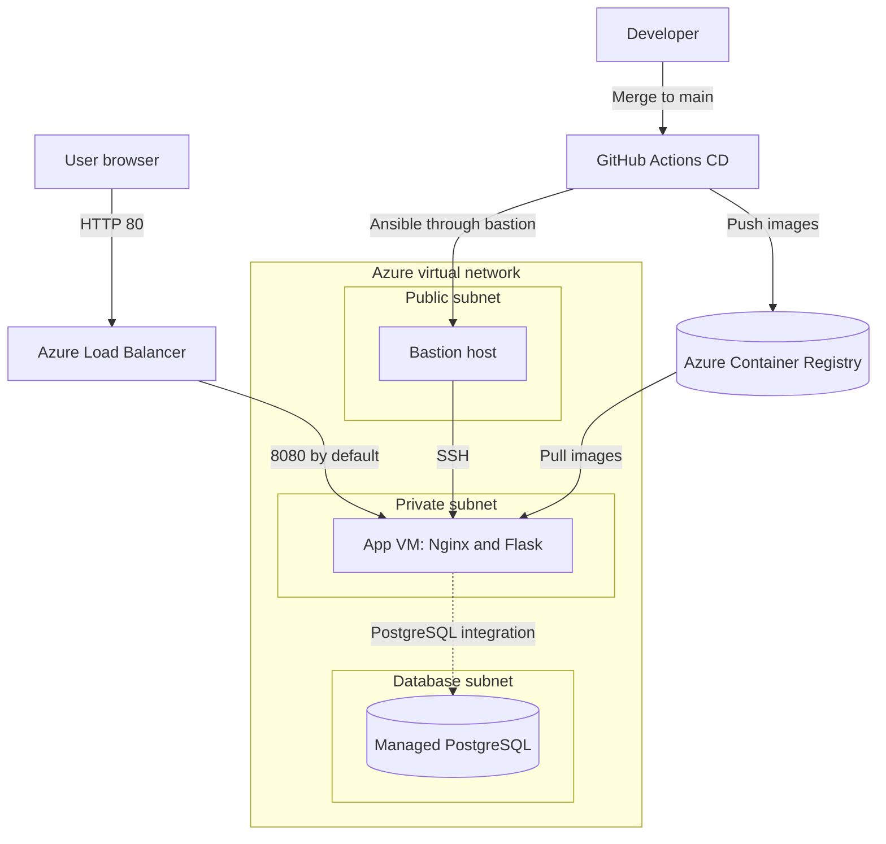

# AgroCompare

**Compare agricultural prices. Make smarter market decisions.**

## African Context

Smallholder farmers across East Africa often lack information about crop prices in nearby markets. Traders and middlemen may have better access to that information, leaving farmers at a disadvantage.

AgroCompare brings crop prices from several markets into one place, helping farmers compare markets and make informed selling decisions.

**The application currently uses sample data for demonstration, not real market prices.**

## Team Members

- Jongkuch Isaac Chol Anyar ([@Jongkuch1](https://github.com/Jongkuch1)) — Team Lead / DevOps
- Agertu Diriba Aliko ([@AgertuDA](https://github.com/AgertuDA)) — Backend
- Betelhem Feleke Cheleno ([@Betelhemf567](https://github.com/Betelhemf567)) — Frontend, Tests and CI
- Beni Niyogisubizo ([@be-niy](https://github.com/be-niy)) — Project Board and Documentation

## Project Overview

AgroCompare is a web application for comparing agricultural prices across sample East African markets.

A Flask API reads bundled JSON data and returns it to a React frontend. Users can filter observations by product or market and compare the same product across markets.

The project combines planning and collaboration from F1, containerization and CI from F2, infrastructure and security work from F3, and the Summative Git-to-Production workflow.

## Target Users

- Smallholder farmers deciding where to sell.
- Small traders comparing market prices.
- Agricultural extension officers advising farmers.

## Core Features

- View sample prices for crops including maize, tomatoes, onions, teff and potatoes.
- Filter observations by product or market.
- Compare a product across two markets.
- View the date associated with each observation.
- Display bundled fallback data with a notice when the API is unavailable.

A populated frontend does not by itself prove API connectivity. Check for the fallback-data notice during verification.

## Technology Stack

| Area | Technology |
| --- | --- |
| Frontend | React 18, JavaScript, Vite and CSS |
| Backend | Python, Flask and Flask-CORS |
| Application data | Bundled JSON |
| Tests | pytest and Node's built-in test runner |
| Containers | Docker and Docker Compose |
| CI/CD | GitHub Actions |
| Security | pip-audit, npm audit, Trivy, Gitleaks and Checkov |
| Infrastructure | Terraform and Azure |
| Configuration management | Ansible |
| Cloud services | Azure VMs, Load Balancer, Container Registry and managed PostgreSQL |

The cloud architecture and deployment workflow are described below.

## Getting Started

### Prerequisites

- Git.
- Node.js 18 or newer, compatible with the frontend dependencies.
- Python 3.11, matching backend CI.
- npm.

For a container-based setup, see **Run with Docker Compose**.

### Clone the repository

```bash
git clone https://github.com/Jongkuch1/AgroCompare.git
cd AgroCompare
```

### Start the backend

From the repository root:

```bash
cd backend
python3 -m venv venv
source venv/bin/activate
python -m pip install -r requirements.txt
python app.py
```

The API runs at `http://localhost:5000`.

### Start the frontend

In another terminal, from the repository root:

```bash
cd frontend
npm install
npm run dev
```

Open the URL printed by Vite, normally `http://localhost:5173`.

The development server proxies `/api` requests to the backend.

### Run tests

Install dependencies first and activate the backend virtual environment.

Run each command from the repository root:

```bash
(cd backend && python -m pytest)
(cd frontend && npm test)
```

### Usage

Use the search and market filters to narrow observations. Use the comparison section to compare a product across two markets.

Inspect the API directly:

```bash
curl -fsS http://localhost:5000/api/health
curl -fsS http://localhost:5000/api/prices
curl -fsS "http://localhost:5000/api/prices?product=maize"
curl -fsS "http://localhost:5000/api/prices?market=m-a"
```

Expected health response:

```json
{"status":"ok"}
```

`/api/prices` returns `products`, `markets` and `observations`. Each observation includes a product, market, price, currency, unit and date.

See [frontend/README.md](frontend/README.md) and [backend/README.md](backend/README.md).

## Project Structure

| Path | Purpose |
| --- | --- |
| `backend/` | Flask API, sample data and tests |
| `frontend/` | React application, tests and frontend Dockerfile |
| `Dockerfile` | Backend image |
| `docker-compose.yml` | Frontend and backend services |
| `.github/workflows/` | CI, security and deployment workflows |
| `terraform/` | Azure infrastructure configuration |
| `ansible/` | Playbook, inventory and roles |
| `docs/DEMO_CHECKLIST.md` | Individual demo checklist |
| `SECURITY.md` | Findings, decisions and security controls |
| `CHANGELOG.md` | Evolution across assignments |

## Links

- [Repository](https://github.com/Jongkuch1/AgroCompare.git)
- [Project Board](https://github.com/users/Jongkuch1/projects/7)
- [Issues](https://github.com/Jongkuch1/AgroCompare/issues)
- [Pull Requests](https://github.com/Jongkuch1/AgroCompare/pulls)
- [Team Participation Sheet](https://docs.google.com/spreadsheets/d/1apJFWX5-BIjBpPVhniaPmolSvizBKX4rTitMLN0pWt4/edit?gid=0#gid=0)

## Collaboration and Branch Protection

Changes are developed on branches and submitted through pull requests.

The team's protection rules require reviewed changes, passing checks and resolved conversations before merging. Confirm the current rules in GitHub Settings when preparing the demonstration.

Use `Closes #N` in a PR description when its merge should close an issue.

## Run with Docker Compose

### Prerequisites

- Docker Engine with the Compose plugin, or Docker Desktop.
- Ports 8080 and 5000 available.
- On Windows with WSL, Docker Desktop integration enabled for Ubuntu.

Local Python and Node.js installations are not required for this method.

### Build and start

From the repository root:

```bash
docker compose up --build -d
```

The frontend starts after the backend health check passes.

- Frontend: http://localhost:8080
- Backend health: http://localhost:5000/api/health
- Prices: http://localhost:5000/api/prices

Nginx serves the built frontend and forwards `/api/` requests to the backend.

### Check status

```bash
docker compose ps
curl -fsS http://localhost:5000/api/health
curl -fsS http://localhost:8080/api/health
```

Both health requests should return `{"status":"ok"}`.

The second request checks the frontend proxy path. Only the backend currently has a Compose health check.

### Logs

```bash
docker compose logs --tail=100 backend frontend
docker compose logs -f backend frontend
```

Press Ctrl+C to stop following logs without stopping containers.

### Stop and rebuild

```bash
docker compose down
docker compose up --build -d
```

The application currently reads sample JSON packaged in the backend image. Dataset changes require rebuilding that image.

### Troubleshooting

| Problem | Action |
| --- | --- |
| Docker unavailable in WSL | Enable Ubuntu under Docker Desktop's WSL Integration settings |
| Docker daemon unavailable | Start Docker Desktop or Docker Engine and run `docker info` |
| Port already allocated | Stop the conflicting process or container |
| Backend unhealthy | Inspect `docker compose logs backend` |
| Frontend fails to start | Check backend health and Compose status |
| API requests fail | Test both health URLs and inspect frontend/backend logs |
| Page shows fallback data | Verify the backend directly |
| Build fails | Inspect the first error and check dependency downloads |

## Continuous Integration

Application CI is defined in `.github/workflows/ci.yml`.

It runs on pushes to branches other than `main` and pull requests targeting `main`.

| Job | Checks |
| --- | --- |
| `frontend-tests` | Dependency installation, lint, tests and frontend build |
| `backend-tests` | Dependency installation, Flake8 and pytest |
| `docker-build` | Backend and frontend image builds |

Security checks are described in [SECURITY.md](SECURITY.md).

To inspect a run:

1. Open GitHub Actions.
2. Select the workflow and relevant commit.
3. Open each job and inspect its steps.
4. Correct failures and push the fix to the same branch.

Required checks must be configured in GitHub branch protection to prevent merging when they fail.

<!-- Owner: be-niy (Summative Part 4: README, architecture diagram, CHANGELOG, observability) -->

## Production Deployment (Azure)

This section documents the deployed system: how it is built, how a change reaches it, and how to check that it is healthy.

**Live app:** http://172.198.71.15

**Health check:** http://172.198.71.15/api/health

### Architecture

Solid connections are in use. The dashed connection is provisioned but not yet used: the application still reads bundled JSON and does not connect to the database.



| Part | Purpose | Defined in |
| --- | --- | --- |
| Network | Public, private and database subnets with NSGs | `terraform/network.tf`, `terraform/database.tf` |
| Bastion | SSH entry point | `terraform/bastion.tf` |
| App VM | Private VM running the application | `terraform/compute.tf` |
| Load balancer | Public web entry point and `/api/health` probe | `terraform/loadbalancer.tf` |
| Registry | Authenticated Azure Container Registry | `terraform/registry.tf` |
| Database | Managed PostgreSQL with public access disabled | `terraform/database.tf` |
| Configuration | Docker installation, server configuration and deployment | `ansible/` |
| Pipeline | CI, security checks and the CD workflow | `.github/workflows/` |

ACR has its shared administrator account disabled. Its network endpoint is public; image access requires authentication.

The application still reads bundled JSON data. Verify database connection settings and application use separately from database provisioning.

### How a Change Reaches Production

A change reaches production in this sequence:

1. Open a pull request.
2. Run lint, tests, dependency scans, Docker builds, image scans and IaC scans.
3. Obtain the required review and merge to `main`.
4. Run the CD checks, build both images and publish them to ACR.
5. Authenticate to Azure and allow the deployment runner's SSH access as required.
6. Run Ansible through the bastion to authenticate to ACR, pull images and restart the application.
7. Remove any temporary SSH rule.
8. Smoke-test the public `/api/health` endpoint and exercise the application.

These stages are defined in `.github/workflows/cd.yml`. The deploy role does not build on the server: it logs in to the private registry and pulls the images that the pipeline already scanned and pushed. The inventory comes from Terraform outputs locally, or from repository variables when the pipeline runs.

### Set Up from Scratch

Prerequisites:

- Terraform, Azure CLI and Git.
- An Azure subscription.
- An SSH key pair.
- Ansible and the collections in `ansible/requirements.yml` (`community.docker` and `community.general`).

From the repository root:

```bash
az login
cd terraform
cp terraform.tfvars.example terraform.tfvars
```

Fill in the required region, allowed administrator IP range and public key path.

```bash
terraform init
terraform fmt -check
terraform validate
terraform plan
```

Review the plan and resource costs, then provision:

```bash
terraform apply
```

Protect Terraform state: it contains the generated database password. Do not commit state, private keys, credentials or sensitive variable files.

### Deployment Settings

The CD workflow reads the following settings from the repository's Actions variables and secrets.

Run Terraform output commands from `terraform/`.

| Kind | Name | Source |
| --- | --- | --- |
| Variable | `ACR_NAME` | `terraform output -raw registry_name` |
| Variable | `AZURE_RESOURCE_GROUP` | `terraform output -raw resource_group_name` |
| Variable | `BASTION_NSG_NAME` | `terraform output -raw bastion_nsg_name` |
| Variable | `BASTION_IP` | `terraform output -raw bastion_public_ip` |
| Variable | `APP_PRIVATE_IP` | `terraform output -raw app_private_ip` |
| Variable | `LB_PUBLIC_IP` | `terraform output -raw lb_public_ip` |
| Variable | `DB_HOST` | `terraform output -raw db_host` |
| Secret | `DB_PASSWORD` | Generated database password |
| Secret | `SSH_PRIVATE_KEY` | Deployment private key |
| Secret | `AZURE_CREDENTIALS` | Credentials for the deployment identity, if used by the final workflow |

`AZURE_CREDENTIALS` belongs to a service principal limited to the project's resource group. Never display secret values in the demo.

Retrieve the intended public URL after provisioning:

```bash
terraform output -raw app_url
```

An output URL alone does not establish that deployment succeeded.

### Observability

Run these checks after deployment and record the actual results.

| Signal | How to inspect it | What it tells an operator |
| --- | --- | --- |
| Public health | `curl -fsS http://<live-ip>/api/health` | The public request reaches the backend through the HTTP proxy path |
| Load balancer probe | Inspect backend/probe health in Azure | The VM responds to the configured HTTP probe |
| Backend health | `docker compose ps` | The backend's internal health check passes |
| Logs | `docker compose logs --tail=100 backend frontend` | Recent requests, output and errors emitted by the services |
| Application use | Exercise filtering and comparison | User-facing features work; check for fallback notices |
| Deployment run | Inspect the completed CD run | Which deployment stages passed; confirm the deployed revision separately |

The health endpoint does not establish database connectivity or verify every application feature.

Access the private VM through the bastion using the configured account and SSH key:

```bash
ssh -J <admin-user>@<bastion-ip> <admin-user>@<app-private-ip>
```

On the VM:

```bash
cd /opt/agrocompare
sudo docker compose ps
sudo docker compose logs --tail=100 backend frontend
curl -fsS http://localhost:8080/api/health
```

Expected response:

```json
{"status":"ok"}
```

Only the backend has a Compose health check. Adjust the localhost URL if the application port changes.

### Teardown

Coordinate teardown with the team and assessment requirements. Keep the submitted application available for the agreed review period.

When the environment is no longer required, run from `terraform/`:

```bash
terraform destroy
```

Review before confirming. This removes managed resources, including the database.

## Security, History and Demo

- [Security findings](SECURITY.md)
- [Changelog](CHANGELOG.md)
- [Demo checklist](docs/DEMO_CHECKLIST.md)

## License

MIT License. See [LICENSE](LICENSE).
